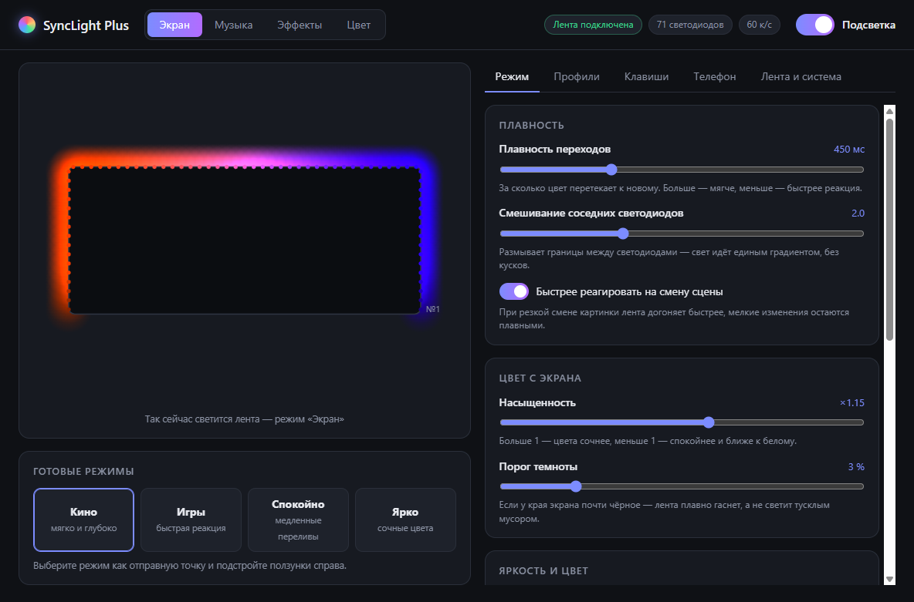
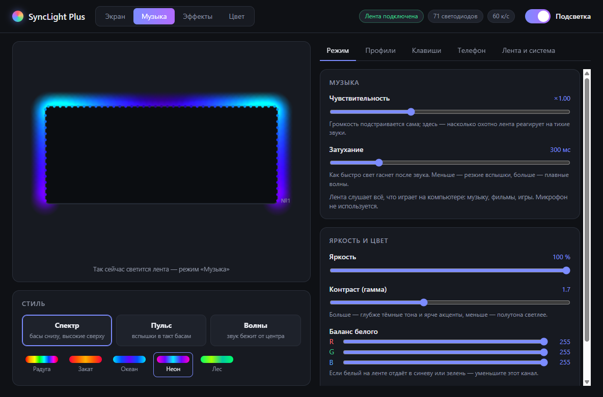
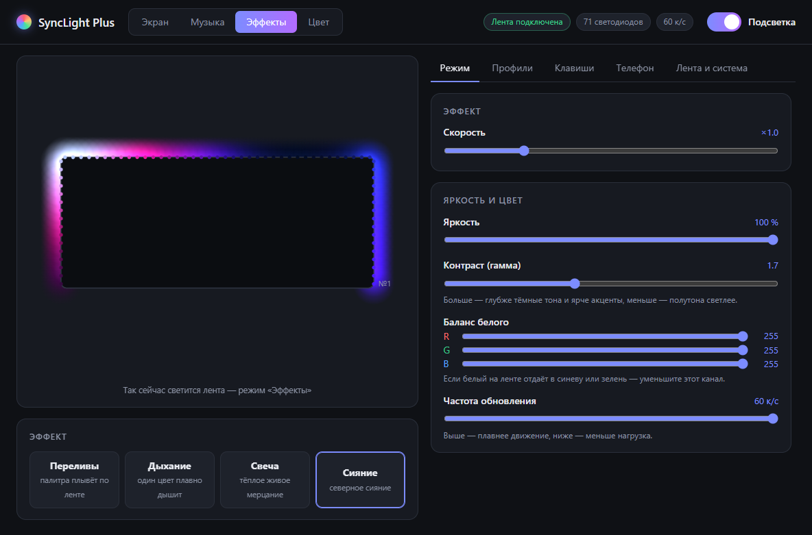
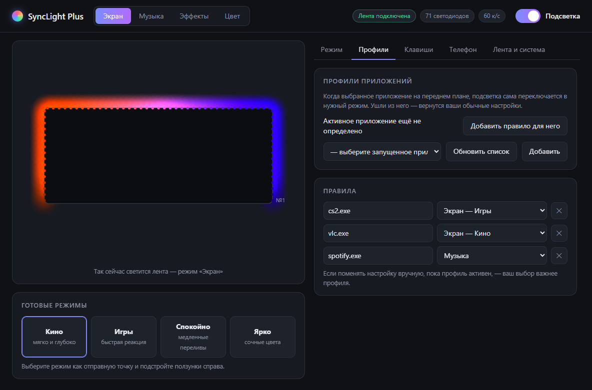
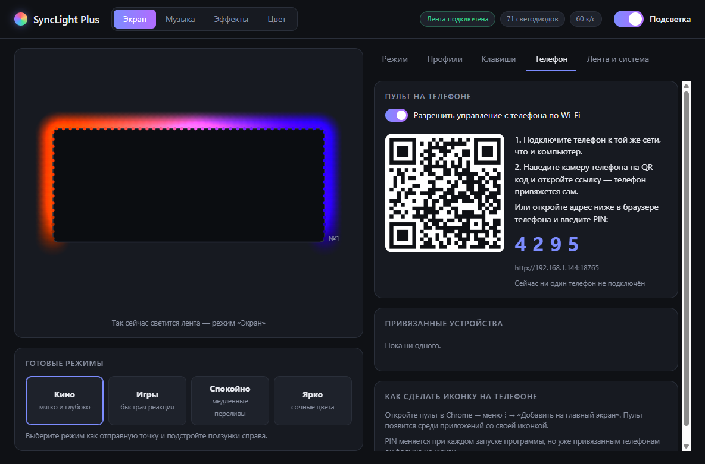
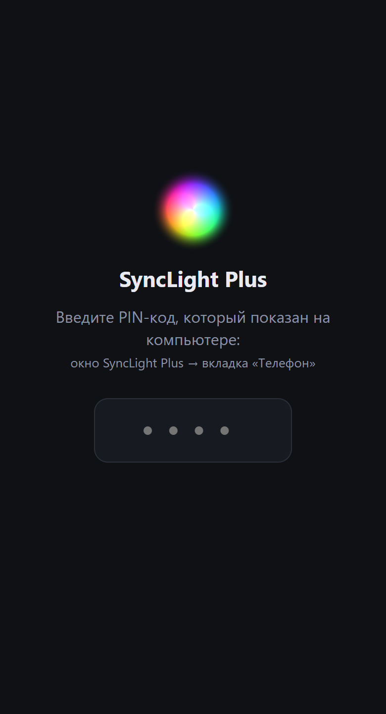
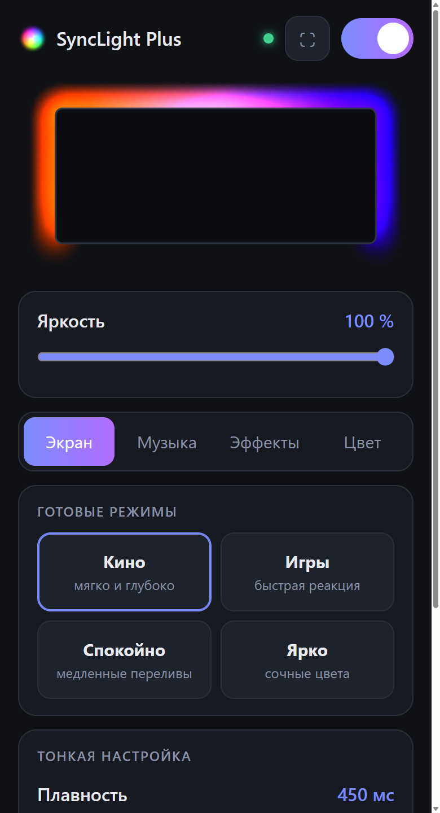
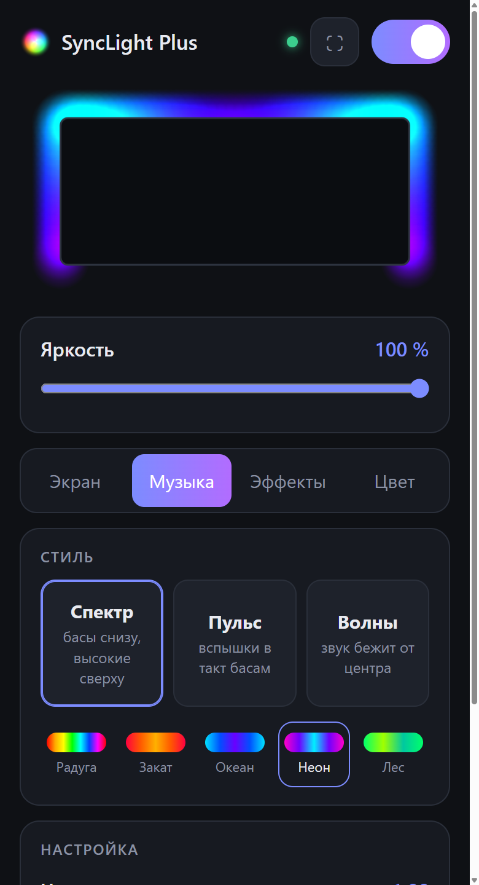
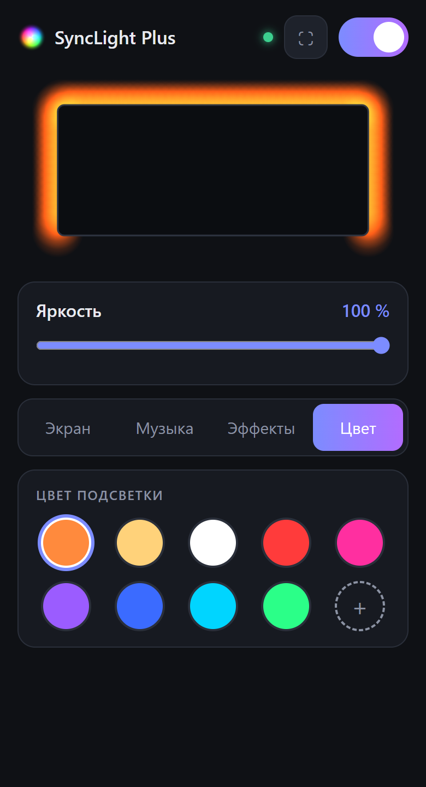

# SyncLight Plus

Неофициальная замена программы **SyncLight** (Robobloq) для USB-подсветки монитора: плавный Ambilight,
светомузыка, эффекты, профили приложений, горячие клавиши и пульт с телефона по Wi-Fi.

> [!WARNING]
> **Сделано и проверено только для одной модели — ZX Sync LED Strip** (Robobloq, USB `VID 1A86 / PID FE07`,
> прошивка 1.8.2, 71 светодиод, монитор 34" 3440×1440, лента на трёх сторонах).
>
> Другие ленты Robobloq/SyncLight могут работать по тому же протоколу, но это **не проверялось**. Используйте на свой
> риск. Программа соблюдает ограничение по питанию оригинального SyncLight (R+G+B ≤ 255 на светодиод) — лента питается
> от USB, и превышать его нельзя. Проект не связан с Robobloq.

<p align="center">
  
</p>

## Возможности

| Режим | Что делает |
|---|---|
| **Экран (Ambilight)** | Каждый светодиод берёт свой цвет со своего участка у края экрана. Участки перекрываются, соседние светодиоды смешиваются — свет идёт сплошным градиентом, без «кусков». Плавные переходы с ускорением на смене сцены, мягкое затухание в темноте, игнор чёрных полос в фильмах. 60 кадров/с. |
| **Музыка** | Слушает весь звук компьютера (не микрофон). Стили: *спектр* (басы на нижних концах ленты, высокие — сверху по центру), *пульс* (вспышки на ударах баса), *волны* (звук бежит от центра). Автоподстройка громкости, 5 палитр. |
| **Эффекты** | Переливы палитры, дыхание, свеча, северное сияние. |
| **Цвет** | Статичный цвет. |

А также:

- **Профили приложений** — «когда на переднем плане `cs2.exe` → режим *Игры*». Ушли из приложения — вернулись ваши настройки.
- **Горячие клавиши** (переназначаются): `Ctrl+Alt+L` — вкл/выкл, `Ctrl+Alt+M` — следующий режим, `Ctrl+Alt+↑/↓` — яркость.
- **Пульт на телефоне** по Wi-Fi — см. [ниже](#пульт-на-телефоне).
- Иконка в трее, автозапуск с Windows, плавный переход между режимами, живое превью ленты.

<table>
  <tr>
    <td></td>
    <td></td>
  </tr>
  <tr>
    <td align="center">Музыка — спектр, палитра «Неон»</td>
    <td align="center">Эффекты — северное сияние</td>
  </tr>
  <tr>
    <td></td>
    <td></td>
  </tr>
  <tr>
    <td align="center">Профили приложений</td>
    <td align="center">Подключение телефона</td>
  </tr>
</table>

### Почему плавнее оригинала

Оригинальный SyncLight делит экран на крупную сетку, берёт **один пиксель** из центра каждой зоны и растягивает её
цвет на несколько светодиодов подряд, без сглаживания во времени. Отсюда «рваные куски» и мерцание.
SyncLight Plus усредняет целую область для каждого светодиода, размывает границы между соседями и сглаживает
изменения во времени уже после цветокоррекции — поэтому переходы длятся ровно столько, сколько задано, и не
упираются в лимит питания.

## Установка

1. Скачайте `SyncLight Plus Setup x.y.z.exe` из [Releases](../../releases) и установите.
   Установщик не подписан — Windows может показать «Windows защитила ваш компьютер» → «Подробнее» → «Выполнить в любом случае».
2. **Закройте оригинальный SyncLight** (и уберите его из автозапуска) — иначе обе программы будут слать цвета одновременно.
   SyncLight Plus сам предупредит, если SyncLight запущен, и предложит его закрыть.
3. На вкладке «Лента и система» нажмите «Проверить раскладку» и при необходимости поправьте число светодиодов
   на сторонах и направление ленты.

## Пульт на телефоне

Отдельное приложение на телефон ставить не нужно: SyncLight Plus сам раздаёт в домашней сети страницу-пульт,
которая открывается в браузере телефона и добавляется на главный экран как приложение.

<p align="center">
  
  
  
  
</p>

### Как подключить

1. Телефон и компьютер — в одной домашней сети (компьютер может быть подключён к роутеру кабелем).
2. Откройте вкладку **«Телефон»** в программе и наведите камеру телефона на QR-код — пульт откроется и привяжется сам.
   Либо откройте показанный адрес (`http://<IP-компьютера>:8765`) и введите PIN.
3. В Chrome: меню ⋮ → **«Добавить на главный экран»** — появится иконка.

### Как это работает

```
 Телефон (браузер)                         Компьютер (SyncLight Plus)
 ─────────────────                         ──────────────────────────
 GET  /                 ───────────────▶   страница пульта (HTML/JS/CSS)
 POST /api/pair {pin}   ───────────────▶   PIN верный → случайный токен
 WebSocket /ws?token=…  ◀══════════════▶   настройки и состояние (JSON),
                                           превью ленты (~15 кадров/с, бинарно)
 {"type":"set", …}      ───────────────▶   проверка → применение → лента
```

- Внутри программы работает небольшой веб-сервер (порт **8765**). Он отдаёт страницу пульта и держит постоянное
  соединение (WebSocket) с каждым телефоном: изменения применяются мгновенно в обе стороны, превью ленты на телефоне
  обновляется вживую. Уснувший телефон переподключается сам.
- **Привязка.** PIN из 4 цифр показывается в программе и меняется при каждом её запуске. QR-код содержит адрес вместе
  с PIN, поэтому при сканировании вводить ничего не нужно. Привязанный телефон получает случайный 256-битный токен и
  дальше подключается по нему; на компьютере хранятся только хеши токенов (`remote-devices.json`).
  Кнопка «Отвязать все устройства» сразу отключает телефоны и аннулирует их токены.
- **Защита.** После 5 неверных PIN привязка блокируется на минуту. Без токена соединение не устанавливается.
  С телефона можно менять только «пультовые» настройки (вкл/выкл, яркость, режимы, пресеты, стили, эффекты, цвета) —
  все значения проверяются и обрезаются до допустимых; раскладку, профили, горячие клавиши и автозапуск с телефона
  изменить нельзя. Пульт можно выключить на вкладке «Телефон».

### Если телефон пишет «Не удаётся установить соединение»

- Сеть в Windows должна быть **«Частной»**: Параметры → Сеть и Интернет → ваше подключение → Тип профиля сети →
  Частная. Программа предупредит, если сеть «Общедоступная».
- Брандмауэр должен пропускать SyncLight Plus **в частных сетях**. Если при первом запуске доступ разрешили, когда сеть
  ещё была «Общедоступной», правило создастся только для общедоступных сетей. Исправить: `Win+R` → `firewall.cpl` →
  «Разрешение взаимодействия с приложением…» → поставить галочку «Частная» у SyncLight Plus. Либо (PowerShell от имени
  администратора) — разрешить только порт пульта и только в домашней сети:
  ```powershell
  New-NetFirewallRule -DisplayName "SyncLight Plus - пульт" -Direction Inbound -Action Allow -Protocol TCP -LocalPort 8765 -Profile Private -Program "C:\Program Files\SyncLight Plus\SyncLight Plus.exe"
  ```
- В гостевых Wi-Fi сетях часто включена изоляция клиентов — устройства не видят друг друга.

Пульт работает только в домашней сети и только пока компьютер включён и программа запущена.
Сайт открывается по обычному `http`, поэтому Chrome может показывать его со строкой адреса — для этого в пульте есть
кнопка «на весь экран» (⛶).

## Сборка из исходников

Нужен Node.js 20+ (проверено на 24).

```
npm install
npm start          # запуск без установки
npm test           # проверки ядра, режимов и сервера пульта (лента не нужна)
npm run dist       # установщик в dist/
```

Отладка: `SLP_DEBUG=1 npm start` — частота кадров, режим и профиль в консоль;
`SLP_REMOTE_HOST=127.0.0.1 npm start` — пульт только на этом ПК (без запроса брандмауэра).

## Устройство проекта

| Путь | Что внутри |
|---|---|
| `src/device.js` | Драйвер ленты по USB HID. Протокол описан в [`docs/PROTOCOL.md`](docs/PROTOCOL.md) |
| `src/engine/ambilight.js` | Кадр экрана → цвета светодиодов (области, размытие, сглаживание, цветокоррекция) |
| `src/engine/music.js`, `effects.js` | Светомузыка; эффекты и общий выходной каскад (гамма, яркость, лимит питания) |
| `src/engine/engine.js` | Скрытое окно: захват экрана и звука, режимы, переходы |
| `src/main.js` | Главный процесс: лента, профили, горячие клавиши, трей, настройки |
| `src/apps.js` | Какое приложение Windows сейчас на переднем плане |
| `src/remote.js`, `src/remote/` | Сервер пульта и страница для телефона |
| `src/ui/` | Окно настроек |
| `src/shared/presets.js` | Режимы, пресеты, палитры, сцены профилей |

Протокол ленты восстановлен по поведению оригинальной программы SyncLight 2.22.1 — исходный код Robobloq в проект
не входит.
